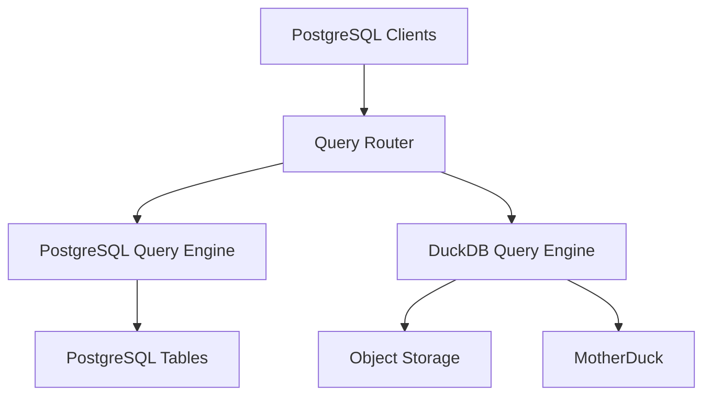

# duckdb/pg_duckdb

> PostgreSQL extension that runs analytical queries with DuckDB, for anyone who wants OLAP without leaving Postgres.

## The problem
Heavy aggregations on PostgreSQL tables are slow, and reading Parquet on S3 forces you to export or add a second engine.

## What it actually does
With `duckdb.force_execution = true`, `SELECT`s on Postgres tables go through the DuckDB engine without changing the SQL. The extension reads and writes Parquet, CSV, JSON, Iceberg and Delta from S3, GCS, Azure and R2, and joins these files with local tables. MotherDuck is an option for remote compute.

## How it is wired


## Trying it
```bash
docker run -d -e POSTGRES_PASSWORD=duckdb pgduckdb/pgduckdb:18-v1.2.0
```

## Cost and gotchas
Free, MIT. A MotherDuck account and token are needed only for the cloud option. Advanced types (STRUCT, MAP, UNION) require the DuckDB execution context.

## What it is not
Not a separate warehouse: everything runs inside the Postgres process. Not fully compatible: the README points to a "gotchas" guide for syntax. Supports PostgreSQL 14 to 18.

## Alternatives
No alternative named in the README; DuckDB alone remains the baseline option without Postgres.

## For you
Adopt as a trial: you keep your data in Postgres and speed up analytics, with a ready-made Docker image to validate on your own tables.
