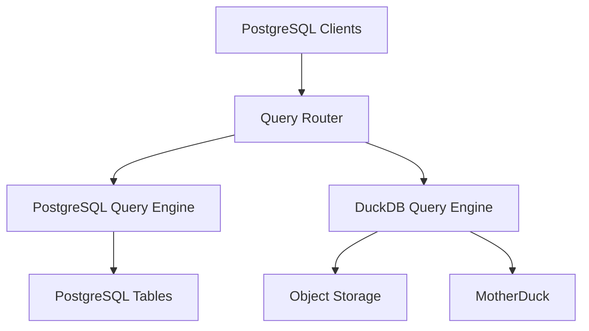

# duckdb/pg_duckdb

> Extension PostgreSQL qui exécute les requêtes analytiques avec DuckDB, pour qui veut de l'OLAP sans quitter Postgres.

## Le problème
Les agrégations lourdes sur des tables PostgreSQL sont lentes, et lire du Parquet sur S3 oblige à exporter ou à ajouter un second moteur.

## Ce que ça fait vraiment
Avec `duckdb.force_execution = true`, les `SELECT` sur tables Postgres passent par le moteur DuckDB sans changer le SQL. L'extension lit et écrit Parquet, CSV, JSON, Iceberg et Delta depuis S3, GCS, Azure et R2, et joint ces fichiers avec des tables locales. MotherDuck est une option de calcul distant.

## Comment c'est branché


## Essayer
```bash
docker run -d -e POSTGRES_PASSWORD=duckdb pgduckdb/pgduckdb:18-v1.2.0
```

## Coût et pièges
Gratuit, MIT. Un compte et un jeton MotherDuck sont nécessaires seulement pour l'option cloud. Les types avancés (STRUCT, MAP, UNION) demandent le contexte d'exécution DuckDB.

## Ce que ce n'est pas
Pas un entrepôt séparé : tout tourne dans le processus Postgres. Pas de compatibilité totale : le README renvoie à un guide de « gotchas » pour la syntaxe. Supporte PostgreSQL 14 à 18.

## Alternatives
Aucune alternative nommée dans le README ; DuckDB seul reste l'option de base sans Postgres.

## Pour toi
À adopter en test : tu gardes tes données dans Postgres et tu accélères l'analytique, avec une image Docker prête pour valider sur tes propres tables.

