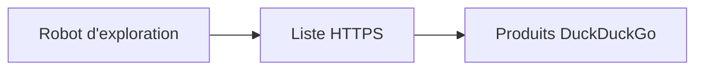

# duckduckgo/smarter-encryption

> List of sites known to support HTTPS, produced by DuckDuckGo's crawler.

## The problem
A browser or extension needs to know which sites accept HTTPS in order to redirect the user there.

## What it actually does
The repository contains the crawler that generates the list, under the Apache 2.0 license according to the README. The list itself is published under CC BY-NC-SA 4.0; commercial use requires a license. No run instructions are given.

## How it is wired
Simplified diagram based on the sheet, no diagram provided.

## Trying it
No documented command.

## Cost and gotchas
Non-commercial list by default: separate license for commercial use. The catalog flags a license that is present but unidentified. Last push on 2025-11-24.

## What it is not
Not a list free of commercial-use restrictions, and not a guide to using the crawler.

## Alternatives
No alternative named in the README; a blog post is cited for comparison.

## For you
Ignore: the non-commercial license and the lack of instructions make it of little use for a data project.
