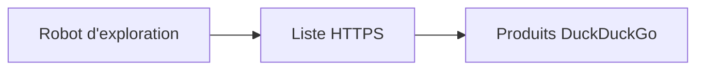

# duckduckgo/smarter-encryption

> Liste de sites connus pour gérer HTTPS, produite par le robot de DuckDuckGo.

## Le problème
Un navigateur ou une extension doit savoir quels sites acceptent HTTPS pour y rediriger l'utilisateur.

## Ce que ça fait vraiment
Le dépôt contient le robot d'exploration qui génère la liste, sous licence Apache 2.0 d'après le README. La liste elle-même est publiée sous CC BY-NC-SA 4.0 ; l'usage commercial demande une licence. Aucune instruction d'exécution n'est donnée.

## Comment c'est branché
Schéma simplifié d'après la fiche, sans diagramme fourni.

## Essayer
Aucune commande documentée.

## Coût et pièges
Liste non commerciale par défaut : licence séparée pour un usage commercial. Le catalogue signale une licence présente mais non identifiée. Dernier push le 2025-11-24.

## Ce que ce n'est pas
Pas une liste libre de droits d'usage commercial, et pas un guide d'utilisation du robot.

## Alternatives
Aucune alternative nommée dans le README ; un billet de blog est cité pour la comparaison.

## Pour toi
À ignorer : la licence non commerciale et l'absence de mode d'emploi le rendent peu utile pour un projet data.

