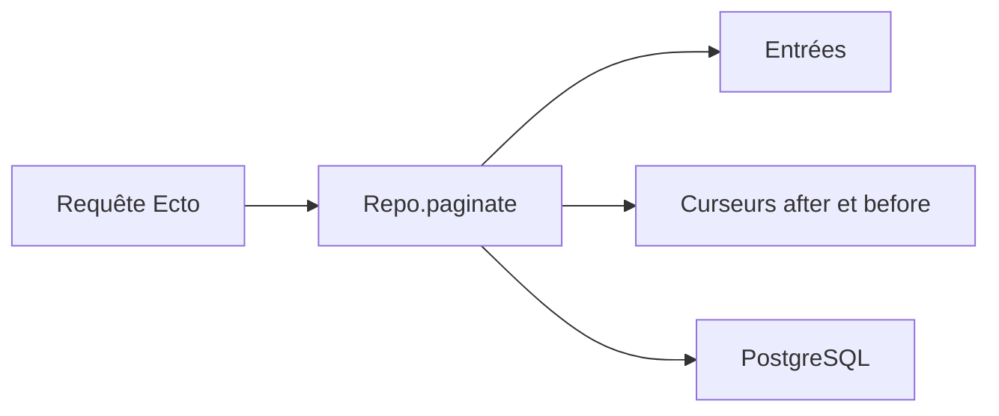

# duffelhq/paginator

> Cursor-based pagination for Elixir Ecto, for APIs or lists over large datasets.

## The problem
`LIMIT/OFFSET` pagination gives shifted results when data changes, and slows down on large tables.

## What it actually does
- Adds `paginate` to the Ecto repo: returns the entries and `after` and `before` cursors.
- Optional total (a separate `COUNT(*)` query).
- Dynamic expressions (full-text ranking example).
- Rejects executable terms in cursors.
- Tested only with PostgreSQL; deterministic ordering and an index on the cursor fields are required.

## How it is wired


## Trying it
```bash
git clone https://github.com/duffelhq/paginator.git
cd paginator
mix deps.get
mix test
```
```elixir
{:paginator, "~> 1.2.0"}
```

## Cost and gotchas
Free. Last push in April 2025. No direct access to a numbered page.

## What it is not
Not page-number pagination. Not validated outside PostgreSQL. Known issue with custom PostgreSQL types.

## Alternatives
No alternative named in the README.

## For you
Ignore: Elixir/Ecto, outside the data / AI scope.
