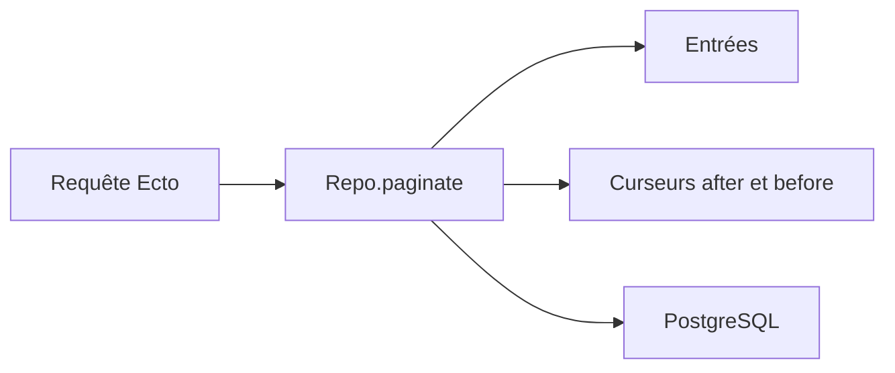

# duffelhq/paginator

> Pagination par curseur pour Elixir Ecto, pour API ou listes sur de gros jeux de données.

## Le problème
La pagination `LIMIT/OFFSET` donne des résultats décalés quand les données changent, et ralentit sur les grandes tables.

## Ce que ça fait vraiment
- Ajoute `paginate` au dépôt Ecto : renvoie les entrées et des curseurs `after` et `before`.
- Total optionnel (une requête `COUNT(*)` séparée).
- Expressions dynamiques (exemple de classement plein texte).
- Rejette les termes exécutables dans les curseurs.
- Testé seulement avec PostgreSQL ; tri déterministe et index sur les champs de curseur requis.

## Comment c'est branché


## Essayer
```bash
git clone https://github.com/duffelhq/paginator.git
cd paginator
mix deps.get
mix test
```
```elixir
{:paginator, "~> 1.2.0"}
```

## Coût et pièges
Gratuit. Dernier push en avril 2025. Pas d'accès direct à une page numérotée.

## Ce que ce n'est pas
Pas une pagination par numéro de page. Pas validé hors PostgreSQL. Problème connu avec des types PostgreSQL personnalisés.

## Alternatives
Aucune alternative nommée dans le README.

## Pour toi
À ignorer : Elixir/Ecto, hors périmètre data / IA.

