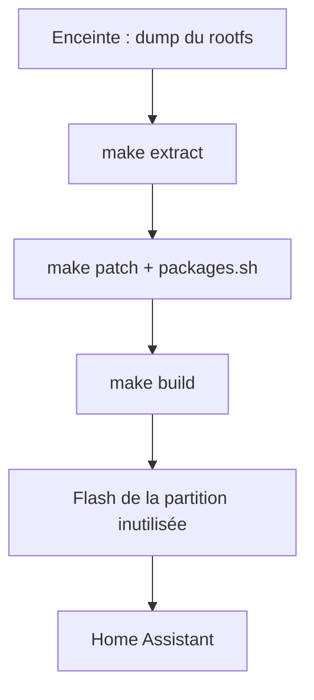

# duhow/xiaoai-patch

> Scripts to rebuild the system of Xiaomi XiaoAi speakers with free software.

## The problem
XiaoAi speakers ship with proprietary software in Chinese, poorly open to streaming protocols or home automation.

## What it actually does
The repository extracts the speaker's rootfs, applies patches and rebuilds an image with MPD, Snapcast, Shairport-Sync, Upmpdcli and Squeezelite. A voice assistant based on Porcupine and Whisper can talk to Home Assistant. Compiling the packages takes more than an hour.

## How it is wired
Simplified diagram based on the sheet, no diagram provided.



## Trying it
```bash
docker build -t xiaoai-patch packages
docker run -it -v $PWD:/xiaoai xiaoai-patch
sudo make clean all FILE=image-mtd4 MODEL=lx06
```

## Cost and gotchas
You need the speaker, soldered wires for TTL in case of failure, `squashfs-tools`, Docker and more than an hour of compilation. Only Linux amd64 is tested. A bad flash can leave the device unusable.

## What it is not
Not a generic software tool: it targets specific hardware. The LX05 and L15A models are encrypted, flashing is discouraged. The author disclaims all responsibility for damage.

## Alternatives
No alternative cited in the README.

## For you
Ignore: hardware tinkering unrelated to data or AI, unless you already own these speakers.
