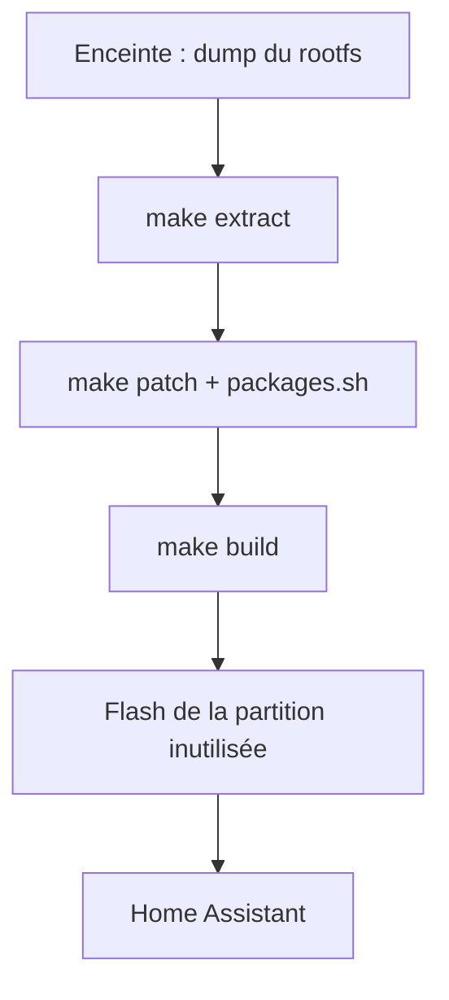

# duhow/xiaoai-patch

> Scripts pour reconstruire le système des enceintes Xiaomi XiaoAi avec des logiciels libres.

## Le problème
Les enceintes XiaoAi embarquent un logiciel propriétaire en chinois, peu ouvert aux protocoles de diffusion ou à la domotique.

## Ce que ça fait vraiment
Le dépôt extrait le rootfs de l'enceinte, applique des correctifs et reconstruit une image avec MPD, Snapcast, Shairport-Sync, Upmpdcli et Squeezelite. Un assistant vocal basé sur Porcupine et Whisper peut dialoguer avec Home Assistant. La compilation des paquets dure plus d'une heure.

## Comment c'est branché
Schéma simplifié d'après la fiche, sans diagramme fourni.



## Essayer
```bash
docker build -t xiaoai-patch packages
docker run -it -v $PWD:/xiaoai xiaoai-patch
sudo make clean all FILE=image-mtd4 MODEL=lx06
```

## Coût et pièges
Il faut l'enceinte, des fils soudés pour le TTL en cas de défaut, `squashfs-tools`, Docker et plus d'une heure de compilation. Linux amd64 seul est testé. Un mauvais flash peut rendre l'appareil inutilisable.

## Ce que ce n'est pas
Pas un outil logiciel générique : il vise du matériel précis. Les modèles LX05 et L15A sont chiffrés, flash déconseillé. L'auteur décline toute responsabilité en cas de dommage.

## Alternatives
Aucune alternative citée dans le README.

## Pour toi
À ignorer : bricolage matériel sans lien avec la donnée ou l'IA, sauf si tu possèdes déjà ces enceintes.

