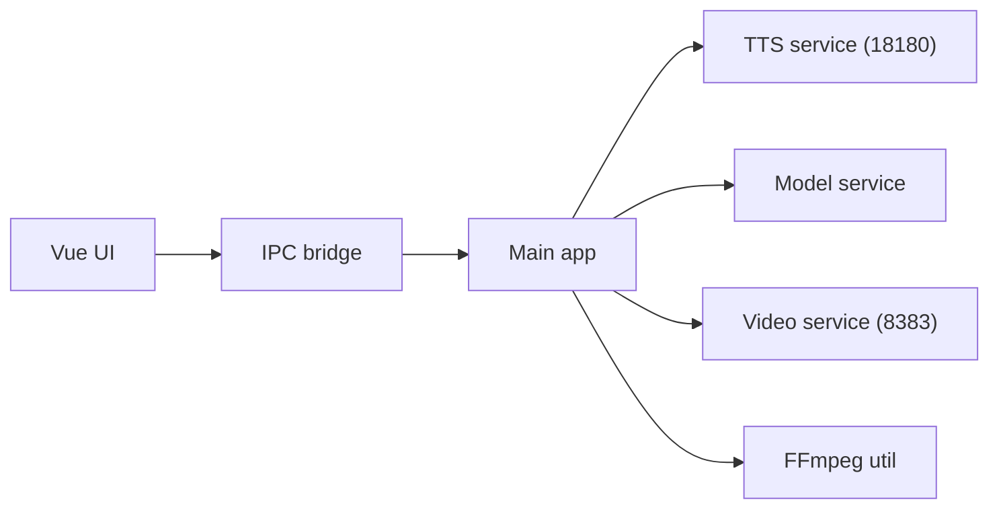

# duixcom/Duix-Avatar

> Offline tool for cloning appearance and voice to generate avatar videos, with an NVIDIA GPU.

## The problem
Producing videos of a digital presenter is expensive and often sends data to an online service.

## What it actually does
An Electron/Vue application drives three local Docker services (ASR fun-asr, TTS fish-speech, Duix.Avatar video synthesis): model training from a video, speech synthesis, lip sync. Local APIs on 127.0.0.1 (ports 18180 and 8383). Windows and Ubuntu 22.04.

## How it is wired


## Trying it
```bash
docker pull guiji2025/fun-asr
docker pull guiji2025/fish-speech-ziming
docker pull guiji2025/duix.avatar
cd deploy && docker-compose up -d
```

## Cost and gotchas
Free but heavy: NVIDIA GPU, 32 GB of RAM recommended, 100 GB free, about 70 GB to download. Commercial use is free except for companies with more than 100,000 users or $10M in revenue (agreement required). License not identified by GitHub.

## What it is not
Not real-time interactive: video synthesis is deferred. No GPU, no services. Voice and face cloning: the risk of misuse is not addressed in the README.

## Alternatives
The README offers its Duix API as a paid service.

## For you
Worth watching: a concrete example of ASR, TTS and lip-sync assembled locally; to be tested only with a suitable GPU and with consent for cloned voices.
