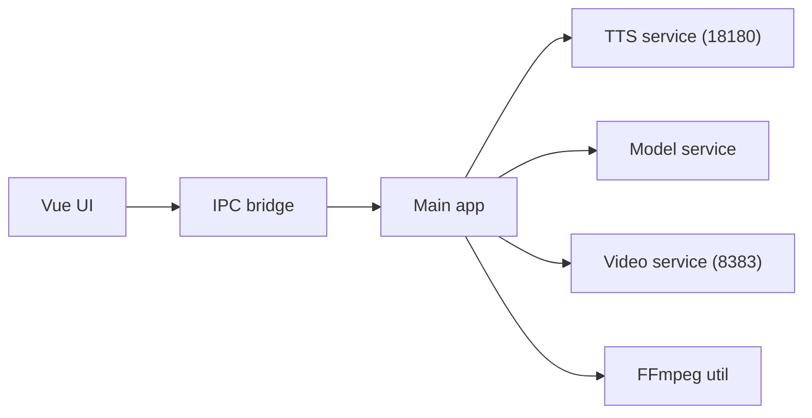

# duixcom/Duix-Avatar

> Outil hors ligne de clonage d'apparence et de voix pour générer des vidéos d'avatar, avec GPU NVIDIA.

## Le problème
Produire des vidéos d'un présentateur numérique coûte cher et envoie souvent les données vers un service en ligne.

## Ce que ça fait vraiment
Une application Electron/Vue pilote trois services Docker locaux (ASR fun-asr, TTS fish-speech, synthèse vidéo Duix.Avatar) : entraînement du modèle à partir d'une vidéo, synthèse vocale, synchronisation labiale. API locales sur 127.0.0.1 (ports 18180 et 8383). Windows et Ubuntu 22.04.

## Comment c'est branché


## Essayer
```bash
docker pull guiji2025/fun-asr
docker pull guiji2025/fish-speech-ziming
docker pull guiji2025/duix.avatar
cd deploy && docker-compose up -d
```

## Coût et pièges
Gratuit mais lourd : GPU NVIDIA, 32 Go de RAM recommandés, 100 Go libres, environ 70 Go de téléchargement. Usage commercial libre sauf entreprises de plus de 100 000 utilisateurs ou 10 M$ de revenu (accord requis). Licence non identifiée par GitHub.

## Ce que ce n'est pas
Pas interactif en temps réel : synthèse vidéo différée. Pas de GPU, pas de services. Clonage de voix et de visage : risque d'usage abusif non traité dans le README.

## Alternatives
Le README propose son API Duix en service payant.

## Pour toi
À surveiller : exemple concret d'ASR, TTS et lip-sync assemblés en local ; à tester seulement avec un GPU adapté et du consentement pour les voix clonées.

