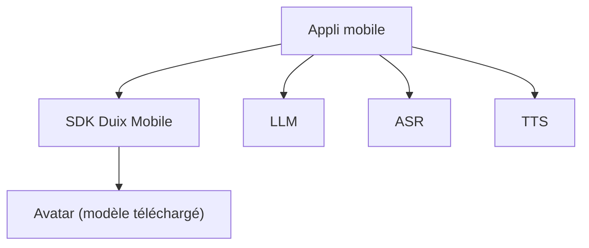

# duixcom/Duix-Mobile

> SDK for displaying a real-time interactive AI avatar on mobile or embedded screens.

## The problem
Give an AI assistant a talking face on a phone or kiosk, without depending on a cloud server.

## What it actually does
Android and iOS SDK that animates an avatar (lip sync, subtitles, streamed audio with interruption). You plug in your own LLM, ASR and TTS. Four public avatars can be downloaded; custom avatars go through an email to support.

## How it is wired

Simplified diagram: the README provides no diagram.

## Trying it
No command documented in the README; it points to the Android and iOS SDK documentation.

## Cost and gotchas
The SDK is presented as local, but the LLM, ASR and TTS must be supplied and may be paid. Custom avatars: commercial contact. License present but not identified by GitHub.

## What it is not
Not a conversation engine: it includes no LLM, ASR or TTS. The latency figures (120 ms) are the manufacturer's, on a single SoC.

## Alternatives
Duix.com (cloud version) and Duix-Avatar (avatar videos), both from the same publisher.

## For you
Ignore unless you have a mobile app project with an avatar: it is an interface SDK, far from data/AI work, and the license needs clarifying.
