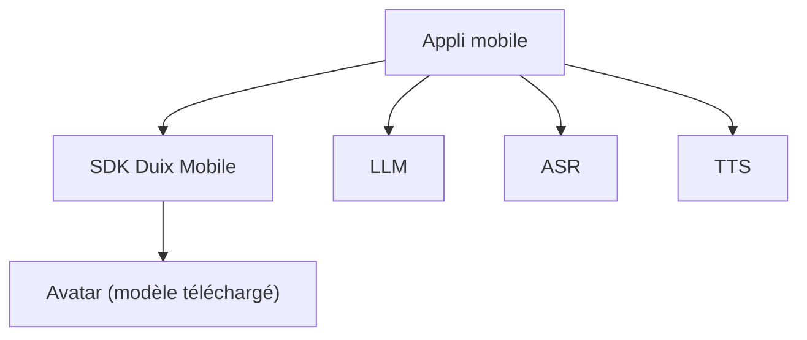

# duixcom/Duix-Mobile

> SDK pour afficher un avatar IA interactif en temps réel sur mobile ou écran embarqué.

## Le problème
Donner un visage parlant à un assistant IA sur téléphone ou borne, sans dépendre d'un serveur cloud.

## Ce que ça fait vraiment
SDK Android et iOS qui anime un avatar (synchronisation labiale, sous-titres, audio en flux avec interruption). Tu branches ton propre LLM, ASR et TTS. Quatre avatars publics sont téléchargeables ; les avatars personnalisés passent par un e-mail au support.

## Comment c'est branché

Schéma simplifié : le README ne fournit pas de diagramme.

## Essayer
Aucune commande documentée dans le README ; il renvoie à la documentation des SDK Android et iOS.

## Coût et pièges
Le SDK est présenté comme local, mais LLM, ASR et TTS sont à fournir et peuvent être payants. Avatars sur mesure : contact commercial. Licence présente mais non identifiée par GitHub.

## Ce que ce n'est pas
Pas un moteur de conversation : il n'inclut ni LLM, ni ASR, ni TTS. Les chiffres de latence (120 ms) sont ceux du fabricant, sur un seul SoC.

## Alternatives
Duix.com (version cloud) et Duix-Avatar (vidéos d'avatar), tous deux du même éditeur.

## Pour toi
À ignorer sauf projet d'app mobile avec avatar : c'est du SDK d'interface, loin du travail data/IA, et la licence est à clarifier.

