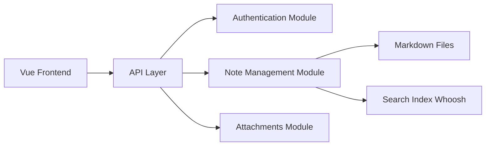

# dullage/flatnotes

> Self-hosted web notes app with no database, which stores Markdown files in a folder.

## The problem
Note-taking apps lock your content into a proprietary format or database.

## What it actually does
Mobile interface, raw Markdown or WYSIWYG editor, full-text search (Whoosh index synchronized on every search), tags, `[[Note]]` wiki links, light/dark themes, authentication (none, read-only, password, 2FA) and a REST API. Python backend, Vue frontend.

## How it is wired


## Trying it
```bash
docker run -d \
  -e "PUID=1000" \
  -e "PGID=1000" \
  -e "FLATNOTES_AUTH_TYPE=password" \
  -e "FLATNOTES_USERNAME=user" \
  -e 'FLATNOTES_PASSWORD=changeMe!' \
  -e "FLATNOTES_SECRET_KEY=aLongRandomSeriesOfCharacters" \
  -v "$(pwd)/data:/data" \
  -p "8080:8080" \
  dullage/flatnotes:latest
```

## Cost and gotchas
Free; change the example password and secret key. Managed hosting is possible on PikaPods (price not specified).

## What it is not
No folders or notebooks: a list of notes with search and tags. Last push August 2026.

## Alternatives
- None cited in the README.

## For you
Worth watching: handy for technical notes as Markdown files that you keep if the tool disappears.
