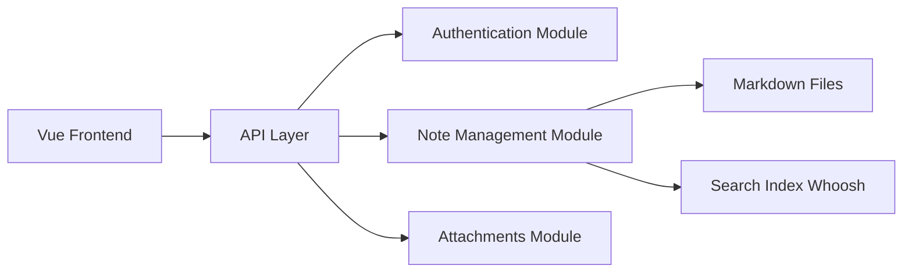

# dullage/flatnotes

> Application web de notes auto-hébergée sans base de données, qui stocke des fichiers Markdown dans un dossier.

## Le problème
Les applis de notes enferment le contenu dans un format ou une base propriétaires.

## Ce que ça fait vraiment
Interface mobile, éditeur Markdown brut ou WYSIWYG, recherche plein texte (index Whoosh synchronisé à chaque recherche), tags, liens wiki `[[Note]]`, thèmes clair/sombre, authentification (aucune, lecture seule, mot de passe, 2FA) et API REST. Backend Python, frontend Vue.

## Comment c'est branché


## Essayer
```bash
docker run -d \
  -e "PUID=1000" \
  -e "PGID=1000" \
  -e "FLATNOTES_AUTH_TYPE=password" \
  -e "FLATNOTES_USERNAME=user" \
  -e 'FLATNOTES_PASSWORD=changeMe!' \
  -e "FLATNOTES_SECRET_KEY=aLongRandomSeriesOfCharacters" \
  -v "$(pwd)/data:/data" \
  -p "8080:8080" \
  dullage/flatnotes:latest
```

## Coût et pièges
Gratuit ; changer le mot de passe et la clé secrète d'exemple. Hébergement géré possible sur PikaPods (prix non précisé).

## Ce que ce n'est pas
Pas de dossiers ni de carnets : une liste de notes avec recherche et tags. Dernier push août 2026.

## Alternatives
- Aucune citée dans le README.

## Pour toi
À surveiller : pratique pour des notes techniques sous forme de fichiers Markdown que tu gardes si l'outil disparaît.

