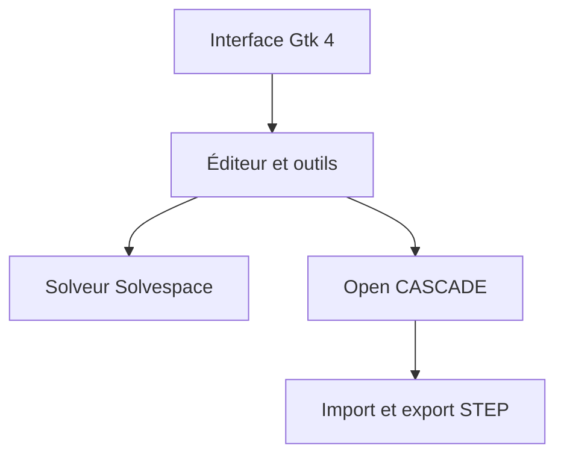

# dune3d/dune3d

> Free parametric 3D CAD software with STEP import and export, fillets and chamfers.

## The problem
FreeCAD and Solvespace do not suit the author: a modal 2D sketcher and fragile references on one side, no STEP and no fillets on the other.

## What it actually does
Parametric CAD with an Open CASCADE kernel (STEP, fillets, chamfers), Solvespace's constraint solver (modified for speed), and the 3D view and editing infrastructure taken from Horizon EDA, with a Gtk 4 interface. Tools are opened from a menu with the space bar; the workplane is defined per group.

## How it is wired
Simplified diagram based on the sheet, no diagram provided.

## Trying it
No command documented in the README: it points to the build instructions.

## Cost and gotchas
Free. It must be compiled on Linux, Windows and macOS (external instructions). GPL-3.0 license (copyleft).

## What it is not
Not a proven replacement for FreeCAD: after three months the author speaks of a "presentable" project.

## Alternatives
FreeCAD: more complete, but a modal sketcher and fragile references. Solvespace: good workflow, but no STEP import and no fillets.

## For you
Ignore: a CAD tool for 3D printing, outside the data/AI/MLOps scope.
