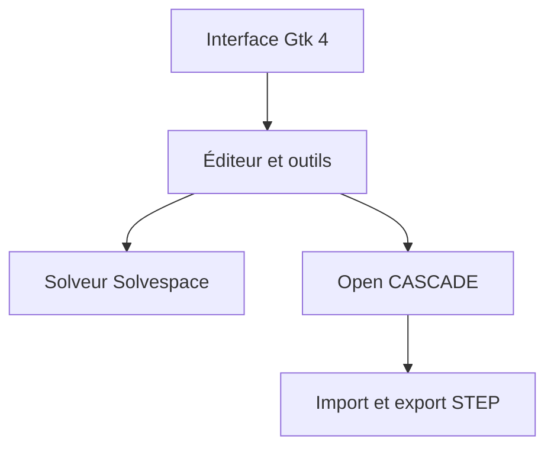

# dune3d/dune3d

> Logiciel de CAO 3D paramétrique libre avec import et export STEP, congés et chanfreins.

## Le problème
FreeCAD et Solvespace ne conviennent pas à l'auteur : esquisseur modal 2D et références fragiles d'un côté, pas de STEP ni de congés de l'autre.

## Ce que ça fait vraiment
CAO paramétrique avec noyau Open CASCADE (STEP, congés, chanfreins), solveur de contraintes de Solvespace (modifié pour la vitesse), vue 3D et infrastructure d'édition reprises de Horizon EDA, interface Gtk 4. Les outils s'ouvrent par le menu à la barre d'espace ; plan de travail défini par groupe.

## Comment c'est branché
Schéma simplifié d'après la fiche, sans diagramme fourni.

## Essayer
Aucune commande documentée dans le README : il renvoie aux instructions de compilation.

## Coût et pièges
Gratuit. Compilation nécessaire sous Linux, Windows et macOS (instructions externes). Licence GPL-3.0 (copyleft).

## Ce que ce n'est pas
Pas un remplaçant éprouvé de FreeCAD : l'auteur parle d'un projet « présentable » après trois mois.

## Alternatives
FreeCAD : plus complet, mais esquisseur modal et références fragiles. Solvespace : bon flux de travail, sans import STEP ni congés.

## Pour toi
À ignorer : outil de CAO pour impression 3D, hors périmètre data/IA/MLOps.

