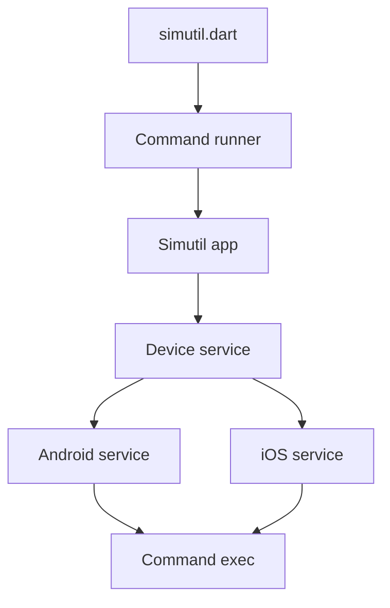

# dungngminh/simutil

> App and CLI to launch, stream, record and control mobile emulators and devices.

## The problem
Starting an emulator or simulator means juggling Android Studio, Xcode, `adb`, `simctl` and scrcpy.

## What it actually does
A desktop app streams and controls several devices side by side (emulators, simulators, real phones), and records and runs YAML scenarios. A `simutil` CLI lists, launches and shuts down devices, reads Logcat and runs YAML plugins. An MCP server lets agents drive them.

## How it is wired


## Trying it
```bash
simutil list -v
simutil launch <device-id>
simutil launch <id> --headless
simutil shutdown <device-id>
simutil schema
```

## Cost and gotchas
Free. The iOS features require macOS and Xcode. An update check runs at most once a day (`SIMUTIL_NO_UPDATE_CHECK=1` to turn it off).

## What it is not
Not a mobile testing tool on its own: it orchestrates `adb`, `simctl` and scrcpy. The architecture described from the code is that of the CLI alone, which is older than the desktop app.

## Alternatives
No alternative named in the README, apart from scrcpy and Maestro, which it integrates as plugins.

## For you
Ignore: a mobile development utility unrelated to data or MLOps.
