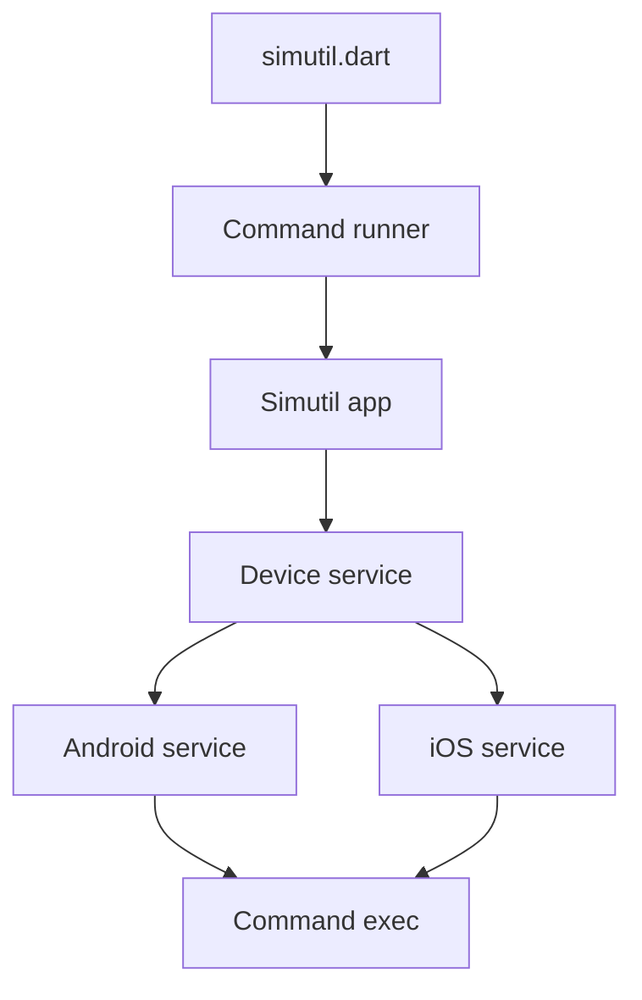

# dungngminh/simutil

> Application et CLI pour lancer, diffuser, enregistrer et piloter émulateurs et appareils mobiles.

## Le problème
Démarrer un émulateur ou simulateur oblige à jongler entre Android Studio, Xcode, `adb`, `simctl` et scrcpy.

## Ce que ça fait vraiment
Une appli de bureau diffuse et contrôle plusieurs appareils côte à côte (émulateurs, simulateurs, téléphones réels), enregistre et exécute des scénarios YAML. Une CLI `simutil` liste, lance, éteint, lit Logcat et exécute des plugins YAML. Un serveur MCP permet aux agents de les piloter.

## Comment c'est branché


## Essayer
```bash
simutil list -v
simutil launch <device-id>
simutil launch <id> --headless
simutil shutdown <device-id>
simutil schema
```

## Coût et pièges
Gratuit. Les fonctions iOS exigent macOS et Xcode. Un contrôle de mise à jour a lieu au plus une fois par jour (`SIMUTIL_NO_UPDATE_CHECK=1` pour le couper).

## Ce que ce n'est pas
Pas un outil de test mobile à lui seul : il orchestre `adb`, `simctl` et scrcpy. L'architecture décrite d'après le code est celle de la CLI seule, plus ancienne que l'appli de bureau.

## Alternatives
Aucune alternative nommée dans le README, hormis scrcpy et Maestro qu'il intègre comme plugins.

## Pour toi
Ignorer : utilitaire de développement mobile sans lien avec la data ou le MLOps.

