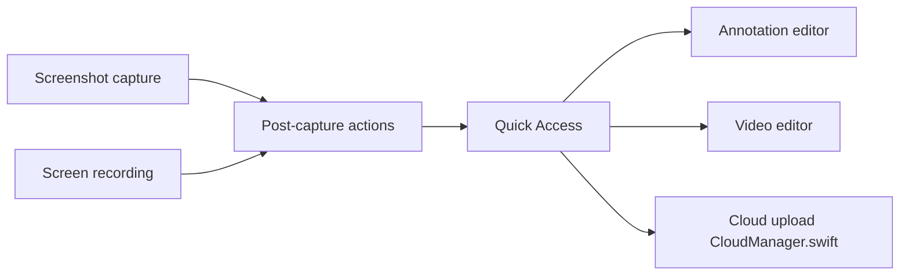

# duongductrong/Snapzy

> macOS menu bar application for screenshots, recordings, annotation and OCR.

## The problem
Capturing, annotating and sharing a screenshot takes several tools; CleanShot X is paid.

## What it actually does
Full-screen, area or scrolling capture, video or GIF recording, annotation and video editors, local OCR (Apple Vision) or through an OpenAI-compatible endpoint, history, upload to S3 or R2 with credentials stored in the Keychain. `snapzy://` URL scheme, Raycast extension. No telemetry according to the README.

## How it is wired


## Trying it
```bash
brew install --cask snapzy
open 'snapzy://capture/area'
```

## Cost and gotchas
Free. macOS 13 minimum. The application is not sandboxed. A custom OCR sends the image to the chosen endpoint.

## What it is not
Not cross-platform: macOS only. OCR scores come from a synthetic corpus; real screenshots give lower results.

## Alternatives
CleanShot X (cited as a source of inspiration, not as a free alternative).

## For you
Ignore: a macOS productivity tool unrelated to data/AI work, mostly useful for documenting demos.
