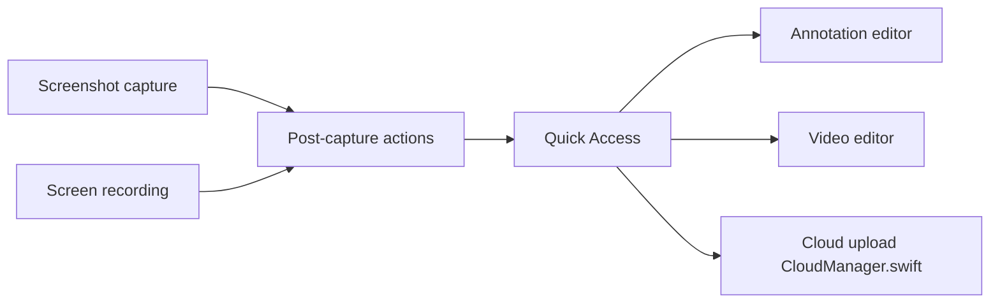

# duongductrong/Snapzy

> Application macOS de barre de menus pour captures d'écran, enregistrements, annotation et OCR.

## Le problème
Capturer, annoter et partager une capture exige plusieurs outils ; CleanShot X est payant.

## Ce que ça fait vraiment
Capture plein écran, zone ou défilante, enregistrement vidéo ou GIF, éditeurs d'annotation et vidéo, OCR local (Apple Vision) ou via un endpoint compatible OpenAI, historique, envoi vers S3 ou R2 avec identifiants dans le Trousseau. Schéma d'URL `snapzy://`, extension Raycast. Aucune télémétrie selon le README.

## Comment c'est branché


## Essayer
```bash
brew install --cask snapzy
open 'snapzy://capture/area'
```

## Coût et pièges
Gratuit. macOS 13 minimum. L'application n'est pas isolée en sandbox. Un OCR personnalisé envoie l'image à l'endpoint choisi.

## Ce que ce n'est pas
Pas multiplateforme : macOS seulement. Les scores OCR viennent d'un corpus synthétique ; les vraies captures donnent moins.

## Alternatives
CleanShot X (cité comme source d'inspiration, pas comme alternative libre).

## Pour toi
À ignorer : outil de productivité macOS sans lien avec le travail data/IA, utile surtout pour documenter des démos.

