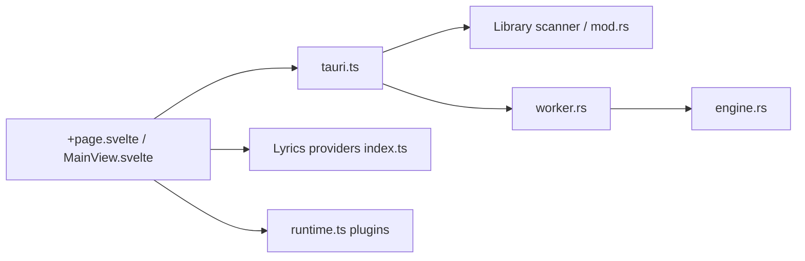

# dupitydumb/Audion

> Cross-platform local music player, inspired by Spotify, with synchronized lyrics and plugins.

## The problem
Local players are often austere, while online services impose an account and tracking.

## What it actually does
Tauri 2 application (SvelteKit + Rust, SQLite) that scans a music folder, extracts metadata, plays FLAC/MP3/AAC/ALAC/Opus and displays LRCLIB/Musixmatch lyrics with word-by-word highlighting, cached locally. JS/WASM plugins, Android Auto, and a self-hosted streaming server in Rust (`audion-server-docker`).

## How it is wired


## Trying it
```bash
git clone https://github.com/dupitydumb/Audion.git
cd audion
npm install
npm run tauri dev
cd audion-server-docker && docker compose up --build -d
```
Or install from the Releases (AUR: `yay -S audion-bin`).

## Cost and gotchas
Free. No license declared: reuse is legally uncertain. The Docker server requires changing the default admin password and JWT secret. Lyrics go through external services.

## What it is not
Not "fully offline" as soon as you enable online lyrics or the server. Nothing AI or data related.

## Alternatives
No alternative cited in the README.

## For you
Ignore: an audio player unrelated to your work, and without a license.
