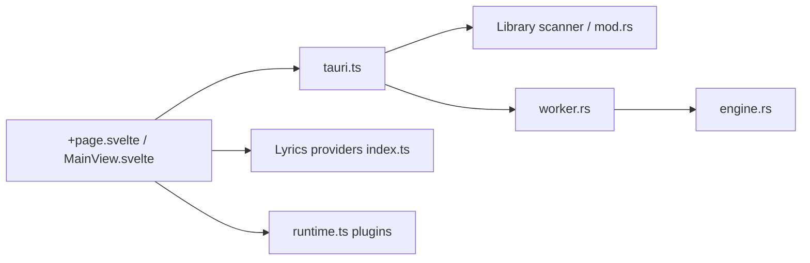

# dupitydumb/Audion

> Lecteur de musique local multiplateforme, inspiré de Spotify, avec paroles synchronisées et plugins.

## Le problème
Les lecteurs locaux sont souvent austères, alors que les services en ligne imposent compte et pistage.

## Ce que ça fait vraiment
Application Tauri 2 (SvelteKit + Rust, SQLite) qui scanne un dossier musical, extrait les métadonnées, lit FLAC/MP3/AAC/ALAC/Opus et affiche des paroles LRCLIB/Musixmatch avec mise en surbrillance mot à mot, en cache local. Plugins JS/WASM, Android Auto, et un serveur de streaming auto-hébergé en Rust (`audion-server-docker`).

## Comment c'est branché


## Essayer
```bash
git clone https://github.com/dupitydumb/Audion.git
cd audion
npm install
npm run tauri dev
cd audion-server-docker && docker compose up --build -d
```
Ou installer depuis les Releases (AUR : `yay -S audion-bin`).

## Coût et pièges
Gratuit. Aucune licence déclarée : réutilisation juridiquement incertaine. Le serveur Docker exige de changer le mot de passe admin et le secret JWT par défaut. Les paroles passent par des services externes.

## Ce que ce n'est pas
Pas « entièrement hors ligne » dès qu'on active paroles en ligne ou serveur. Rien d'IA ou de data.

## Alternatives
Aucune alternative citée dans le README.

## Pour toi
À ignorer : lecteur audio sans lien avec ton métier, et sans licence.

