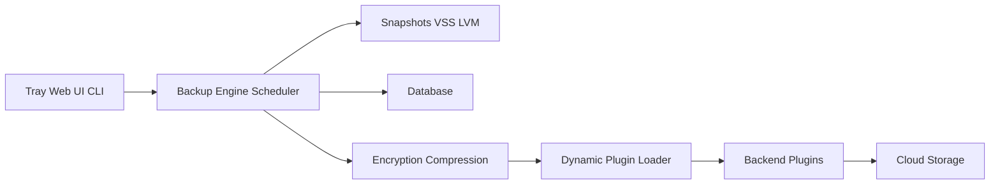

# duplicati/duplicati

> Encrypted, incremental, compressed backup client to cloud storage or remote servers.

## The problem
Back up files off-site, encrypted, without retransferring everything each time.

## What it actually does
A backup engine schedules, computes differences, compresses and encrypts (AES-256 or GPG) before sending. Backend plugins cover S3, B2, Azure, Google Drive, OneDrive, SFTP, WebDAV and others. Controlled via tray icon, web/REST interface or command line; VSS or LVM snapshots for open files.

## How it is wired

## Trying it
No command documented in the README: download the release from the official download page.

## Cost and gotchas
The client is free; remote storage is at your expense. License: the core is under MIT, the `proprietary/` folder under a Duplicati Inc license; GitHub does not recognize the license, hence the alert.

## What it is not
Not a hosted backup service. Losing the encryption password makes the backups unreadable.

## Alternatives
No alternative named in the README.

## For you
Adopt to back up workstations and data off-site; read the license of the proprietary folder before any business use.
