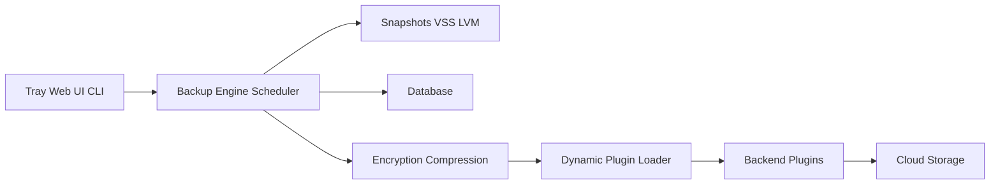

# duplicati/duplicati

> Client de sauvegarde chiffrée, incrémentale et compressée vers des stockages cloud ou serveurs distants.

## Le problème
Sauvegarder des fichiers hors site, chiffrés, sans retransférer l'intégralité à chaque fois.

## Ce que ça fait vraiment
Un moteur de sauvegarde planifie, calcule les différences, compresse et chiffre (AES-256 ou GPG) avant envoi. Des plugins de backend couvrent S3, B2, Azure, Google Drive, OneDrive, SFTP, WebDAV et d'autres. Pilotage par icône de barre, interface web/REST ou ligne de commande ; instantanés VSS ou LVM pour fichiers ouverts.

## Comment c'est branché

## Essayer
Aucune commande documentée dans le README : télécharger la version depuis la page de téléchargement officielle.

## Coût et pièges
Le client est gratuit ; le stockage distant est à ta charge. Licence : le cœur est sous MIT, le dossier `proprietary/` sous licence Duplicati Inc ; GitHub ne reconnaît pas la licence, d'où l'alerte.

## Ce que ce n'est pas
Pas un service de sauvegarde hébergé. Perdre le mot de passe de chiffrement rend les sauvegardes illisibles.

## Alternatives
Aucune alternative nommée dans le README.

## Pour toi
Adopter pour sauvegarder postes et données hors site ; lire la licence du dossier propriétaire avant tout usage en entreprise.

