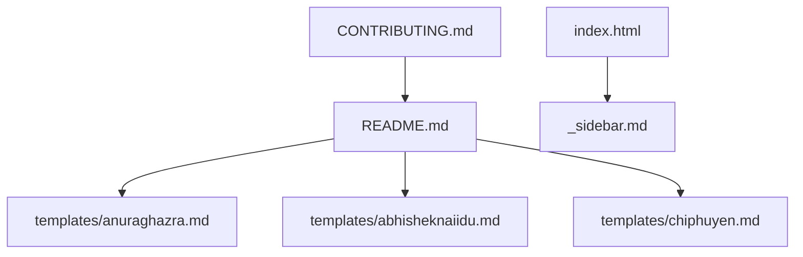

# durgeshsamariya/awesome-github-profile-readme-templates

> Collection of GitHub profile README templates, one file per user.

## The problem
An empty GitHub profile looks bad; you want ready-to-copy templates for your home page.

## What it actually does
The README provided is that of an individual profile (in Portuguese), not a description of the project: the material is insufficient. From the architecture, the repository is a collection of documents: a docsify page and a README point to hundreds of templates in the `templates` folder, one per user, and `CONTRIBUTING.md` explains how to add a template.

## How it is wired

## Trying it
No documented command: browse the `templates` folder and copy a template into your profile repository.

## Cost and gotchas
Free. No license declared: reuse of the templates is not regulated. The templates contain their authors' personal data (the README provided displays an e-mail).

## What it is not
Not a profile generator nor a tool. Not a curated list of the quality of each template.

## Alternatives
No alternative named in the README.

## For you
Ignore: profile decoration, of no value for your work; the missing license also discourages reuse.
