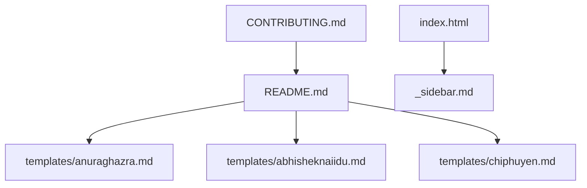

# durgeshsamariya/awesome-github-profile-readme-templates

> Collection de modèles de README de profil GitHub, un fichier par utilisateur.

## Le problème
Un profil GitHub vide fait mauvais effet ; on veut des modèles prêts à copier pour sa page d'accueil.

## Ce que ça fait vraiment
Le README fourni est celui d'un profil individuel (en portugais), pas une description du projet : la matière est insuffisante. D'après l'architecture, le dépôt est un recueil de documents : une page docsify et un README renvoient vers des centaines de modèles dans le dossier `templates`, un par utilisateur, et `CONTRIBUTING.md` explique l'ajout d'un modèle.

## Comment c'est branché

## Essayer
Aucune commande documentée : parcourir le dossier `templates` et copier un modèle dans le dépôt de son profil.

## Coût et pièges
Gratuit. Aucune licence déclarée : la réutilisation des modèles n'est pas encadrée. Les modèles contiennent des données personnelles de leurs auteurs (le README fourni affiche un e-mail).

## Ce que ce n'est pas
Ce n'est pas un générateur de profil ni un outil. Ce n'est pas une liste curée de la qualité de chaque modèle.

## Alternatives
Aucune alternative nommée dans le README.

## Pour toi
À ignorer : décoration de profil, sans valeur pour ton travail ; la licence absente décourage aussi la réutilisation.

