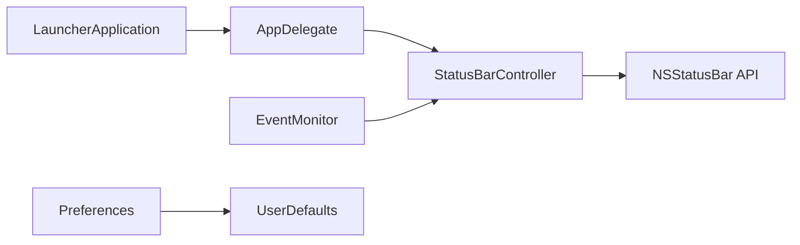

# dwarvesf/hidden

> macOS application that hides menu bar icons to keep it clean.

## The problem
A Mac's menu bar fills up with icons from small applications that clutter it.

## What it actually does
An arrow icon in the menu bar: click it to hide or show the icons placed to its left; rearrange with ⌘ + drag. The Swift/AppKit project has two targets: the main app (`StatusBarController`, `EventMonitor`, preferences in `UserDefaults`) and a launcher for automatic startup via `SMAppService`. No network or server.

## How it is wired


## Trying it
```bash
brew install --cask hiddenbar
```
Otherwise: download the latest release, drag it into Applications, then ⌘ + drag the icon to place it between others.

## Cost and gotchas
Free. Requires macOS 13 (Ventura) or later; the last version for macOS 10.13 to 12 is v1.10. The README states that the app is notarized outside the App Store.

## What it is not
Not a window manager or a full productivity tool; only icon hiding.

## Alternatives
The README mentions other utilities from the same team (Blurred, Micro Sniff, VimMotion), which do something else.

## For you
Ignore: Mac comfort with no link to data/AI/MLOps work; install it if the menu bar bothers you, with no professional stakes.
