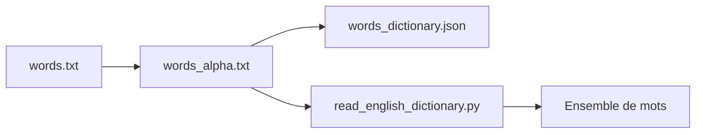

# dwyl/english-words

> Text files of more than 466,000 English words, for autocompletion or database import.

## The problem
You need a raw list of English words, without going through an Excel file.

## What it actually does
Provides `words.txt` (all words), `words_alpha.txt` (letters only) and `words_dictionary.json` (words mapped to 1). A Python example, `read_english_dictionary.py`, loads the list into a set.

## How it is wired


## Trying it
```bash
python read_english_dictionary.py
```
The README gives no other command: you download the files.

## Cost and gotchas
Free. The list comes from an infochimps file about which the README says: "Copyright still belongs to them"; the repository's Unlicense does not settle this origin. Last push January 2025.

## What it is not
Not a dictionary of definitions, nor a cleaned lexicon: it contains rare or dubious words. No quality guarantee in the README.

## Alternatives
No alternative named in the README.

## For you
Worth watching: handy for tests or NLP prototyping, but do not ship it in a product without checking the origin of the rights.
