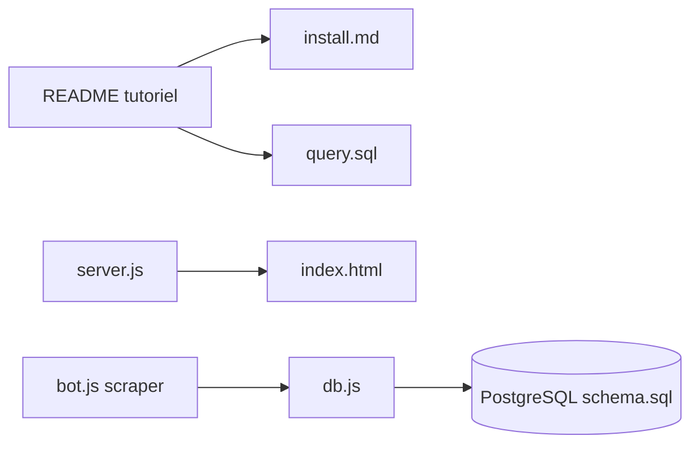

# dwyl/learn-postgresql

> Introductory PostgreSQL and SQL tutorial for beginner developers, covering installation and basic queries.

## The problem
Beginners do not know where to start to store and query data reliably.

## What it actually does
A long README explains why to learn SQL, installs Postgres (Postgres.app on macOS, apt on Ubuntu), creates databases and users, adds PostGIS with an `ST_Distance` example, and summarizes psql commands, joins, grouping and foreign keys. The repo also contains a small Node example with a GitHub scraper and a SQL schema; the guide files were not sampled.

## How it is wired


## Trying it
```bash
sudo apt-get update
sudo apt-get install postgresql postgresql-contrib
sudo -u postgres createuser --interactive
psql
```

## Cost and gotchas
Free. Content is partly dated (links, screenshots) and oriented toward macOS/Ubuntu. No license declared: reuse is uncertain.

## What it is not
Not an advanced reference: no optimization, modeling or MLOps. Not an executable tool.

## Alternatives
No alternative cited in the README (links to external courses).

## For you
Worth watching only as a basic refresher; if you already know SQL, the official PostgreSQL documentation is more useful.
