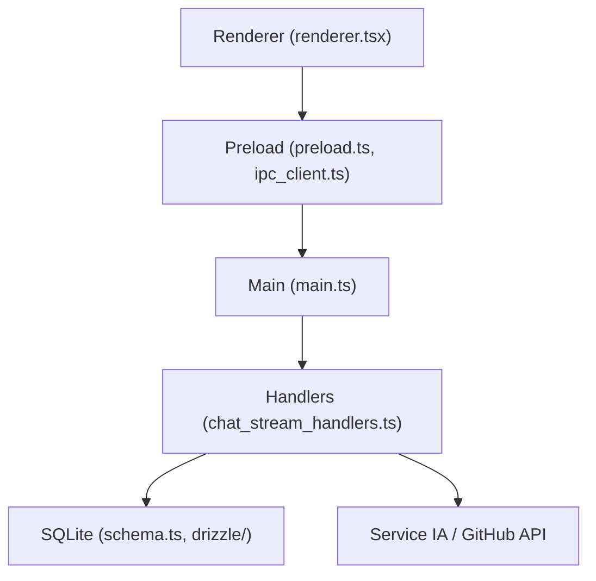

# dyad-sh/dyad

> Local, open source AI app builder, in the style of Lovable or Bolt, on your own machine.

## The problem
AI app generators are hosted, opaque and lock you into a vendor.

## What it actually does
Electron desktop application (React/TypeScript, Vite). The main process handles chat, apps, dependencies, GitHub, settings and shell through typed IPC. Data in SQLite (Drizzle). Calls models with your own keys. No sign-up required.

## How it is wired

## Trying it
The README only says to download the application for your platform (no command).

## Cost and gotchas
Model API keys at your expense. Generated apps run locally through the shell.

## What it is not
Not a hosted service. The README details neither supported models nor the license: a license is present but not identified.

## Alternatives
Lovable, v0 and Bolt, cited as references: hosted, therefore less private.

## For you
Watch: handy for prototyping locally with your keys, but the license needs clarifying.
