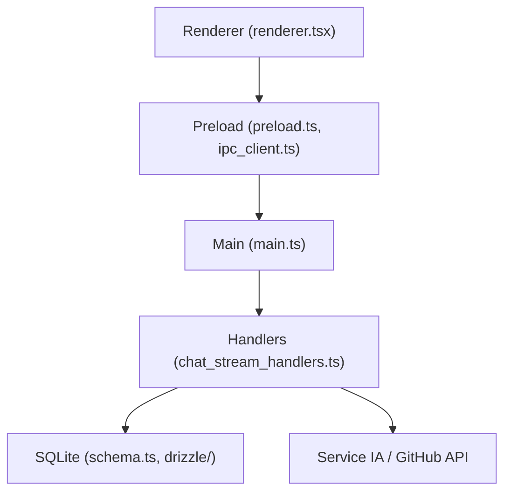

# dyad-sh/dyad

> Constructeur d'applications par IA, local et open source, façon Lovable ou Bolt, sur ta machine.

## Le problème
Les générateurs d'apps par IA sont hébergés, opaques et enferment dans un fournisseur.

## Ce que ça fait vraiment
Application de bureau Electron (React/TypeScript, Vite). Le processus principal gère chat, apps, dépendances, GitHub, paramètres et shell via IPC typé. Données dans SQLite (Drizzle). Appelle des modèles avec tes propres clés. Aucune inscription requise.

## Comment c'est branché

## Essayer
Le README indique seulement de télécharger l'application pour sa plateforme (pas de commande).

## Coût et pièges
Clés d'API de modèles à ta charge. Les apps générées s'exécutent localement via le shell.

## Ce que ce n'est pas
Pas un service hébergé. Le README ne détaille ni modèles pris en charge ni licence : licence présente mais non identifiée.

## Alternatives
Lovable, v0 et Bolt, cités comme référence : hébergés, donc moins privés.

## Pour toi
Surveiller : pratique pour prototyper en local avec tes clés, mais licence à clarifier.

