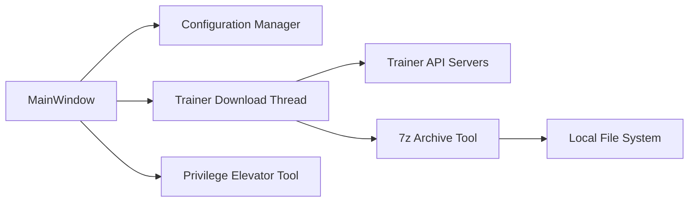

# dyang886/Game-Cheats-Manager

> Windows application that gathers and downloads trainers for single-player games from several sources.

## The problem
Finding, downloading, organizing and updating game trainers (cheat tools) means digging through dubious sites.

## What it actually does
A Python desktop interface: bilingual English/Chinese search, download on double-click (extraction with 7-Zip, filing by folder and version), automatic update at each launch, local import, switchable sources (Fling, XiaoXing, Cheat Tables, the project's own trainers, manually reviewed community trainers). A wizard adds the folders to the Windows Defender exclusions.

## How it is wired

## Trying it
No command: the README describes a 64-bit Windows installer to download from the releases page, run, then launch.

## Cost and gotchas
Free, Windows only. Trainers modify the memory of games and trigger antivirus alerts; the app offers to whitelist them in Defender, which weakens the machine's protection. Third-party binaries are executed; GPL-3.0.

## What it is not
Not a development or analysis tool: it manages cheat executables for single-player games. The README also says it provides instructions for bypassing anti-cheat.

## Alternatives
The README cites its own sources (Fling, XiaoXing, Cheat Tables); no direct alternative named.

## For you
Ignore: a gaming tool unrelated to data/AI/MLOps, which asks you to disable the machine's antivirus monitoring.
