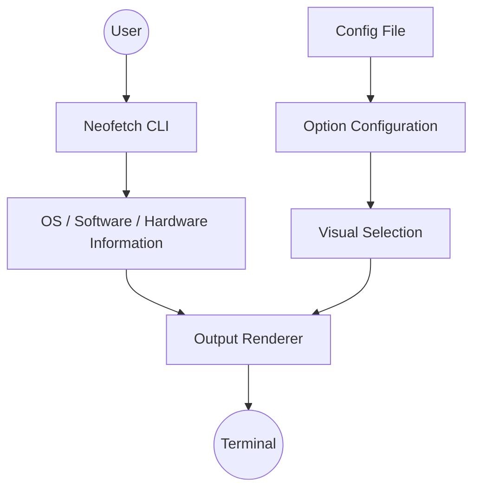

# dylanaraps/neofetch

> Bash script that displays system information and a logo in the terminal, for desktop screenshots.

## The problem
Showing off your setup (OS, software, hardware) in a uniform way in a screenshot requires assembling everything by hand.

## What it actually does
A bash script reads the host's OS, software and hardware, picks a logo or an image, then prints the result in the terminal. Command-line options and a configuration file. Close to 150 supported systems.

## How it is wired

## Trying it
No command documented in the README excerpt (it points to Dependencies, Installation, Wiki).

## Cost and gotchas
Free, bash 3.2+. Archived repository, last push July 2024, 467 open issues.

## What it is not
Not a diagnostic tool: the README points elsewhere for serious statistics.

## Alternatives
No alternative named in the README.

## For you
Ignore: aesthetic gadget, archived, of no value for data / AI / MLOps work.
