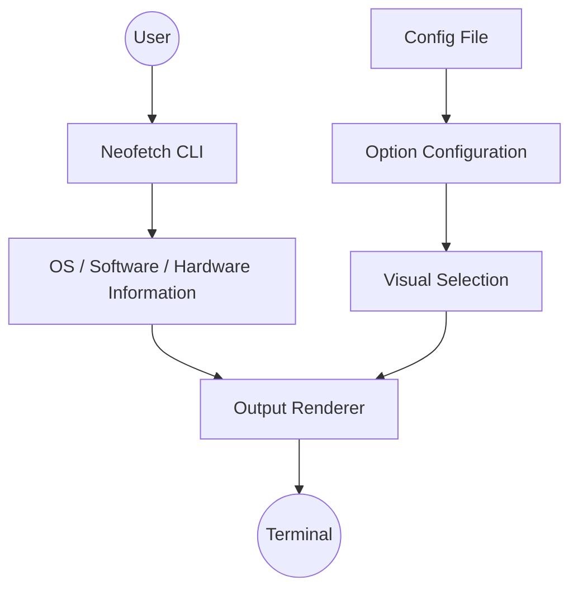

# dylanaraps/neofetch

> Script bash qui affiche infos système et logo dans le terminal, pour les captures d'écran de bureau.

## Le problème
Montrer sa configuration (OS, logiciels, matériel) de façon uniforme dans une capture demande de tout assembler à la main.

## Ce que ça fait vraiment
Un script bash lit OS, logiciels et matériel de l'hôte, choisit un logo ou une image, puis imprime le résultat dans le terminal. Options en ligne de commande et fichier de configuration. Près de 150 systèmes pris en charge.

## Comment c'est branché

## Essayer
Aucune commande documentée dans l'extrait du README (renvoi vers Dependencies, Installation, Wiki).

## Coût et pièges
Gratuit, bash 3.2+. Dépôt archivé, dernier push juillet 2024, 467 issues ouvertes.

## Ce que ce n'est pas
Pas un outil de diagnostic : le README renvoie ailleurs pour les statistiques sérieuses.

## Alternatives
Aucune alternative nommée dans le README.

## Pour toi
Ignorer : gadget esthétique, archivé, sans valeur pour un travail data / IA / MLOps.

