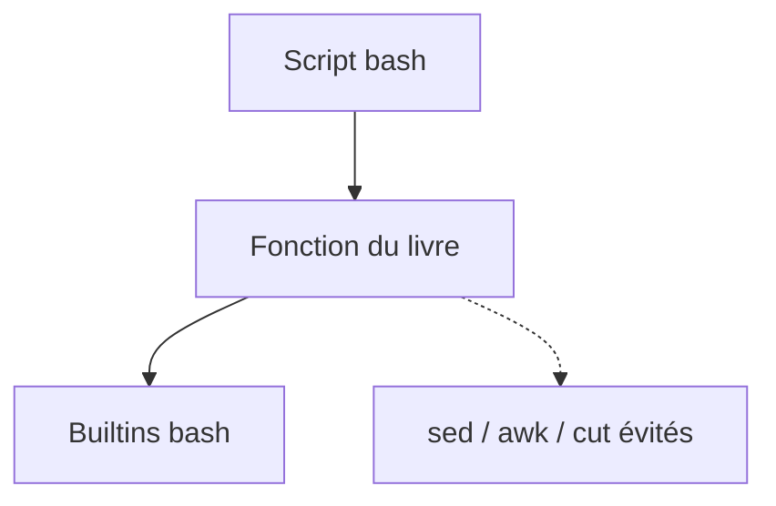

# dylanaraps/pure-bash-bible

> Collection of native bash functions that replace sed, awk, cut or basename, for anyone writing shell scripts.

## The problem
Every call to an external process slows down a bash script and adds a dependency.

## What it actually does
A snippet reference: strings (trim, split, case, regex, URL encoding), arrays, loops, files, paths, escape sequences and parameter expansions. The snippets are checked with shellcheck. Several require bash 4 or later.

## How it is wired
Simplified diagram based on the sheet, no diagram provided.


## Trying it
```bash
$ trim_string "    Hello,  World    "
Hello,  World
```

## Cost and gotchas
Nothing to install, just copy the functions. Repository archived, last push at the end of 2023. Regex depends on the system's engine.

## What it is not
Not an installable library. Not portable everywhere: bash 4+ is required for several snippets.

## Alternatives
No alternative named in the README.

## For you
Watch: useful as a cheat sheet for dependency-free MLOps scripts, but frozen since the archiving.
