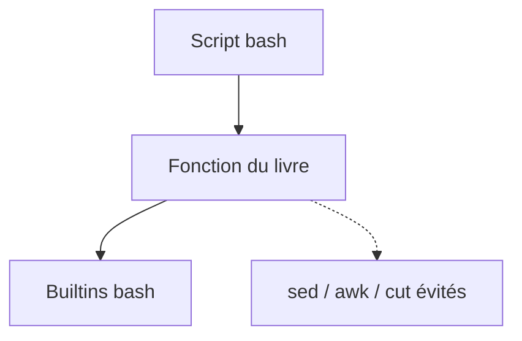

# dylanaraps/pure-bash-bible

> Recueil de fonctions bash natives qui remplacent sed, awk, cut ou basename, pour qui écrit des scripts shell.

## Le problème
Chaque appel à un processus externe ralentit un script bash et ajoute une dépendance.

## Ce que ça fait vraiment
Une référence d'extraits : chaînes (trim, split, casse, regex, encodage URL), tableaux, boucles, fichiers, chemins, séquences d'échappement et expansions de paramètres. Les extraits sont vérifiés avec shellcheck. Plusieurs exigent bash 4 ou plus.

## Comment c'est branché
Schéma simplifié d'après la fiche, sans diagramme fourni.


## Essayer
```bash
$ trim_string "    Hello,  World    "
Hello,  World
```

## Coût et pièges
Rien à installer, il suffit de copier les fonctions. Dépôt archivé, dernier push fin 2023. La regex dépend du moteur du système.

## Ce que ce n'est pas
Pas une bibliothèque installable. Pas portable partout : bash 4+ requis pour plusieurs extraits.

## Alternatives
Aucune alternative nommée dans le README.

## Pour toi
Surveiller : utile comme aide-mémoire pour des scripts MLOps sans dépendances, mais figé depuis l'archivage.

