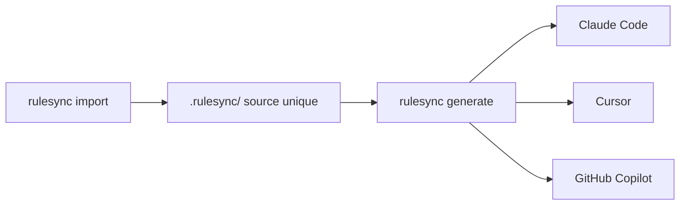

# dyoshikawa/rulesync

> Node CLI that generates the configuration files of dozens of AI coding tools from a single set of rules.

## The problem
Each coding assistant (Claude Code, Cursor, Copilot) wants its own rules, commands and MCP files: you end up maintaining duplicates.

## What it actually does
You write the rules once in `.rulesync/`, and `rulesync generate` produces each tool's files: rules, MCP, commands, subagents, skills, hooks and permissions. `import` picks up existing configurations, `convert` goes directly from one tool to another. The README table covers more than fifty targets, some marked obsolete.

## How it is wired

Simplified diagram based on the sheet, no diagram provided.

## Trying it
```bash
npm install -g rulesync
rulesync init
rulesync fetch dyoshikawa/rulesync
rulesync generate --targets "*" --features "*"
rulesync import --targets claudecode
```

## Cost and gotchas
Free. Several targets are deprecated (Roo Code, Continue, legacy Kiro) and no longer follow new features. Generated files should be reviewed before committing.

## What it is not
Not a coding assistant: it only generates configuration. It does not check that the rules produce the intended behavior in each tool.

## Alternatives
No alternative named in the README.

## For you
Adopt if you use several coding assistants: a single source of rules prevents drift, and installation is one command.
