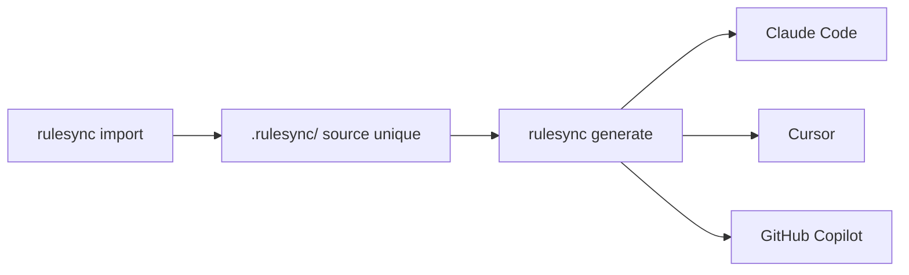

# dyoshikawa/rulesync

> CLI Node qui génère les fichiers de configuration de dizaines d'outils de code IA depuis des règles uniques.

## Le problème
Chaque assistant de code (Claude Code, Cursor, Copilot) veut ses propres fichiers de règles, de commandes et de MCP : on les maintient en double.

## Ce que ça fait vraiment
Tu écris les règles une fois dans `.rulesync/`, et `rulesync generate` produit les fichiers de chaque outil : règles, MCP, commandes, sous-agents, skills, hooks et permissions. `import` récupère des configurations existantes, `convert` passe d'un outil à l'autre directement. Le tableau du README couvre plus de cinquante cibles, certaines marquées obsolètes.

## Comment c'est branché

Schéma simplifié d'après la fiche, sans diagramme fourni.

## Essayer
```bash
npm install -g rulesync
rulesync init
rulesync fetch dyoshikawa/rulesync
rulesync generate --targets "*" --features "*"
rulesync import --targets claudecode
```

## Coût et pièges
Gratuit. Plusieurs cibles sont dépréciées (Roo Code, Continue, Kiro historique) et ne suivent plus les nouveautés. Les fichiers générés sont à surveiller avant validation.

## Ce que ce n'est pas
Pas un assistant de code : il ne fait que générer de la configuration. Il ne vérifie pas que les règles produisent le comportement voulu dans chaque outil.

## Alternatives
Aucune alternative nommée dans le README.

## Pour toi
À adopter si tu utilises plusieurs assistants de code : une seule source de règles évite les dérives, et l'installation tient en une commande.

