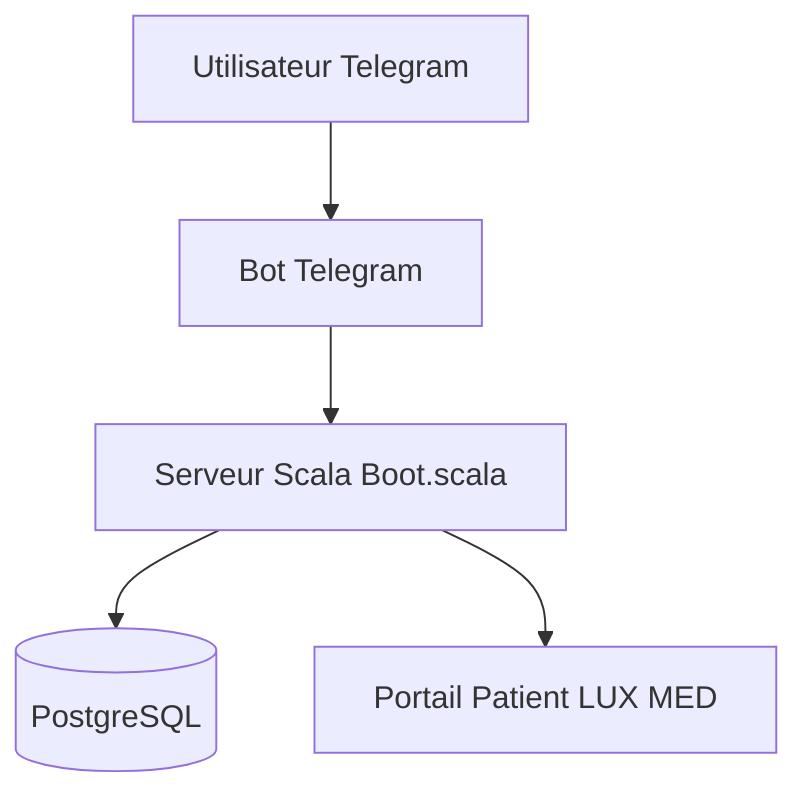

# dyrkin/luxmed-bot

> Unofficial Telegram bot to book and track your medical appointments on the LUX MED portal.

## The problem
Booking a slot with a doctor on the Polish LUX MED portal forces you to keep going back to it.

## What it actually does
A Telegram bot that books visits, watches for slots, and shows upcoming appointments and history. You can use the public instance @luxmedbot or host your own with Docker Compose and a PostgreSQL database.

## How it is wired
Simplified diagram based on the fiche, no diagram provided.



## Trying it
```bash
docker compose pull
docker compose up -d
```
Before that: create the bot with @BotFather, download the docker-compose.yml for your platform, rename secrets.env.template to secrets.env and set TELEGRAM_TOKEN and SECURITY_SECRET in it.

## Cost and gotchas
Free, but you need a LUX MED patient account, a Telegram token and Docker. It depends on the third-party portal: a change on their side can break the bot.

## What it is not
Not a LUX MED product (it is unofficial). Not useful outside Poland. The code is in Scala, which is not in the prerequisites list; only Docker is needed to install it.

## Alternatives
No alternative named in the README.

## For you
Ignore: health tool for patients of a Polish operator, unrelated to data, AI or MLOps work.
