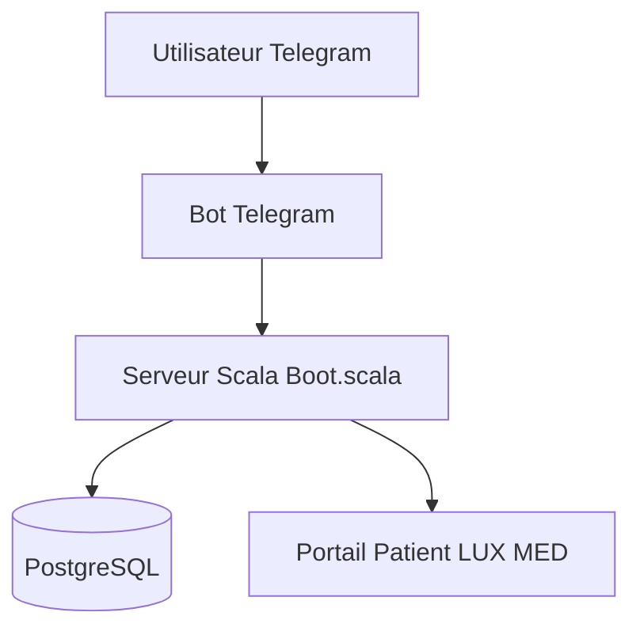

# dyrkin/luxmed-bot

> Bot Telegram non officiel pour réserver et suivre ses rendez-vous médicaux sur le portail LUX MED.

## Le problème
Réserver un créneau chez un médecin sur le portail polonais LUX MED oblige à y retourner sans cesse.

## Ce que ça fait vraiment
Un bot Telegram qui réserve des visites, surveille les créneaux, affiche les rendez-vous à venir et l'historique. On peut utiliser l'instance publique @luxmedbot ou héberger la sienne avec Docker Compose et une base PostgreSQL.

## Comment c'est branché
Schéma simplifié d'après la fiche, sans diagramme fourni.



## Essayer
```bash
docker compose pull
docker compose up -d
```
Avant cela : créer le bot avec @BotFather, télécharger le docker-compose.yml de sa plateforme, renommer secrets.env.template en secrets.env et y mettre TELEGRAM_TOKEN et SECURITY_SECRET.

## Coût et pièges
Gratuit, mais il faut un compte patient LUX MED, un jeton Telegram et Docker. Le fonctionnement dépend du portail tiers : un changement de leur côté peut casser le bot.

## Ce que ce n'est pas
Pas un produit de LUX MED (il est non officiel). Pas utile hors de Pologne. Le code est en Scala, ce qui n'est pas dans la liste des prérequis ; seul Docker est nécessaire pour l'installer.

## Alternatives
Aucune alternative nommée dans le README.

## Pour toi
À ignorer : outil de santé pour les patients d'un opérateur polonais, sans lien avec un travail data, IA ou MLOps.

