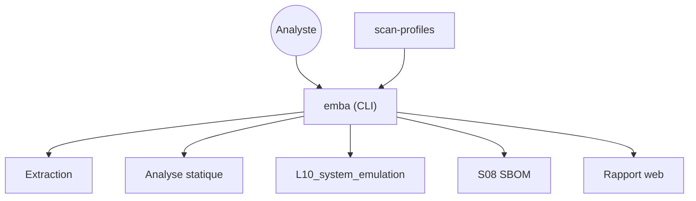

# e-m-b-a/emba

> Command-line analyzer for embedded firmware: extraction, analysis, SBOM and web report, for product security teams.

## The problem
Firmware is a black box: outdated components, vulnerable scripts and hardcoded passwords go unnoticed.

## What it actually does
- Extracts the firmware, then analyzes it statically.
- Optional dynamic analysis by emulating the system.
- Builds an SBOM (inventory of components).
- Produces a vulnerability report viewable in a browser. The tester remains responsible for the interpretation.

## How it is wired


## Trying it
```bash
git clone https://github.com/e-m-b-a/emba.git
cd emba
sudo ./installer.sh -d
sudo ./emba -l ~/log -f ~/firmware -p ./scan-profiles/default-scan.emba
sudo ./emba -l ~/log -f ~/firmware -p ./scan-profiles/default-sbom.emba
```

## Cost and gotchas
Free. The installer and the launch go through `sudo`, and install many dependencies; the machine load is not quantified in the README. GPL-3.0 license.

## What it is not
Not an attack tool: it flags weak points, it does not replace human analysis. Module details come from the wiki, not the README.

## Alternatives
No alternative named in the README.

## For you
Worth watching: relevant if you audit connected hardware or SBOMs, otherwise outside the data / AI scope.
