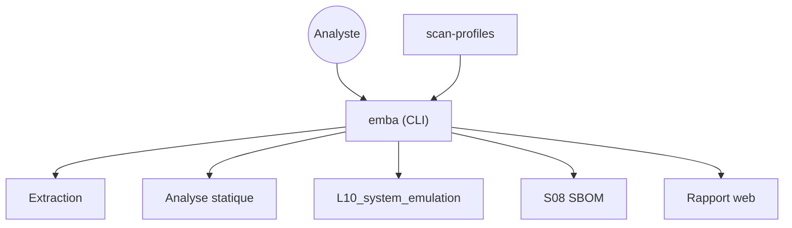

# e-m-b-a/emba

> Analyseur en ligne de commande de firmwares embarqués : extraction, analyse, SBOM et rapport web, pour équipes de sécurité produit.

## Le problème
Un firmware est une boîte noire : composants périmés, scripts vulnérables et mots de passe en dur y passent inaperçus.

## Ce que ça fait vraiment
- Extrait le firmware, puis l'analyse en statique.
- Option d'analyse dynamique par émulation du système.
- Construit une SBOM (inventaire des composants).
- Produit un rapport de vulnérabilités consultable dans un navigateur. Le testeur reste responsable de l'interprétation.

## Comment c'est branché


## Essayer
```bash
git clone https://github.com/e-m-b-a/emba.git
cd emba
sudo ./installer.sh -d
sudo ./emba -l ~/log -f ~/firmware -p ./scan-profiles/default-scan.emba
sudo ./emba -l ~/log -f ~/firmware -p ./scan-profiles/default-sbom.emba
```

## Coût et pièges
Gratuit. L'installateur et le lancement passent par `sudo`, et installent beaucoup de dépendances ; la charge machine n'est pas chiffrée dans le README. Licence GPL-3.0.

## Ce que ce n'est pas
Pas un outil d'attaque : il signale des points faibles, il ne remplace pas l'analyse humaine. Le détail des modules vient du wiki, non du README.

## Alternatives
Aucune alternative nommée dans le README.

## Pour toi
À surveiller : pertinent si tu audites du matériel connecté ou des SBOM, sinon hors périmètre data / IA.

