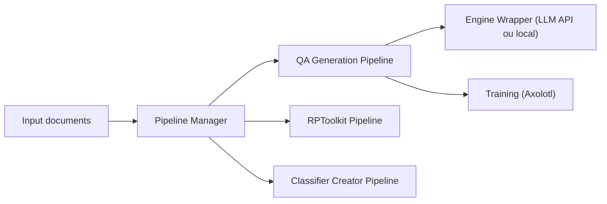

# e-p-armstrong/augmentoolkit

> Pipelines to turn documents into datasets and train a domain-expert LLM.

## The problem
Teaching an LLM a new domain requires producing varied training data and driving the fine-tuning.

## What it actually does
Three pipeline families: factual QA (chunking, questions, validation, answers), RPToolkit (multi-turn role-play) and a classifier creator. Added on top: experimental GRPO, correction, rephrase, RAG. Web interface or CLI, generation via API or local model, training via Axolotl (full finetune advertised at around $20). Automatically resumes interrupted runs.

## How it is wired


## Trying it
```bash
git clone https://github.com/e-p-armstrong/augmentoolkit.git
cd augmentoolkit # Python == 3.11
bash linux.sh
bash local_linux.sh normal
```

## Cost and gotchas
Python 3.11; Valkey required (compiled if missing); fast generation only with a GPU or a paid API; training on a powerful machine or rented. Small datasets: few optimization steps, weak learning.

## What it is not
Not a guarantee of expertise: the README itself notes that small datasets learn poorly. The superlatives ("best way in the world") are the author's and unmeasured.

## Alternatives
No alternative named in the README.

## For you
Worth watching: relevant if you are preparing domain fine-tuning data, but the maintainer is a single person and the real GPU cost remains to be measured.
