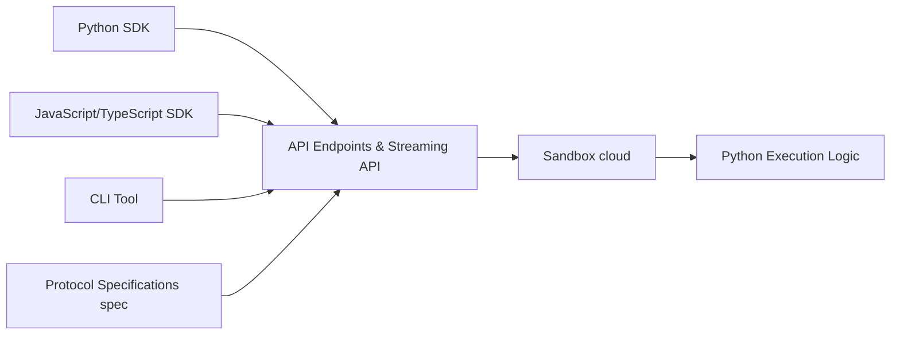

# e2b-dev/E2B

> Isolated cloud sandboxes for running AI-generated code, driven by JS or Python SDKs.

## The problem
Running an LLM agent's code on your machine or server is dangerous; you need disposable isolation.

## What it actually does
`Sandbox.create()` launches an isolated environment; `commands.run()` runs commands.
Code Interpreter SDK: `runCode()` returns the execution results.
Desktop SDK: mouse, keyboard, screenshots, app launching for "computer use".
Infrastructure self-hostable via Terraform on AWS or GCP.

## How it is wired


## Trying it
```bash
pip install e2b
pip install e2b-code-interpreter
npm i e2b
```

## Cost and gotchas
Account and `E2B_API_KEY` required; self-hosting is possible but heavy (Terraform, AWS/GCP, Azure not yet).

## What it is not
Not an agent: just the execution environment. Without self-hosting, your code goes through their cloud.

## Alternatives
No alternative named in the README.

## For you
Adopt it for any agent that runs code (data analysis, code interpreter): clean isolation in a few lines, Apache license.
