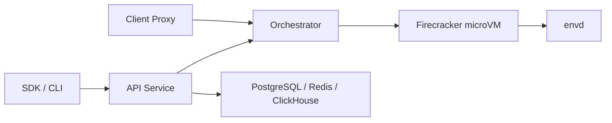

# e2b-dev/infra

> Open source runtime of E2B: Firecracker micro-VMs that run agent code in isolated sandboxes.

## The problem
An agent that runs untrusted code needs an isolated environment that starts fast and can be suspended.

## What it actually does
A sandbox is a restored snapshot: memory served on demand (userfaultfd), copy-on-write disk. Pause and resume with a diff in object storage, forking of a running sandbox, templates built from Docker images, per-sandbox egress firewall. The control plane (Go API) is separate from the per-node orchestrator; `envd` runs inside each VM. OpenTelemetry telemetry to ClickHouse.

## How it is wired


## Trying it
```bash
mkdir e2b && cd e2b
curl -fsSL --remote-name-all "https://raw.githubusercontent.com/e2b-dev/runtime/main/embed/compose/{compose.yaml,.env}"
docker compose up -d --wait
```

## Cost and gotchas
Linux with KVM is required. The Embed package is presented as an evaluation package, not a production deployment. The cloud version requires an API key from e2b.dev.

## What it is not
Not just an SDK: it is the whole infrastructure, heavy to operate yourself. The README talks about the e2b-dev/runtime repo, while the catalog lists e2b-dev/infra.

## Alternatives
- No alternative named in the README.

## For you
Worth watching: relevant if you want to self-host agent code execution; otherwise the E2B cloud service is simpler.
