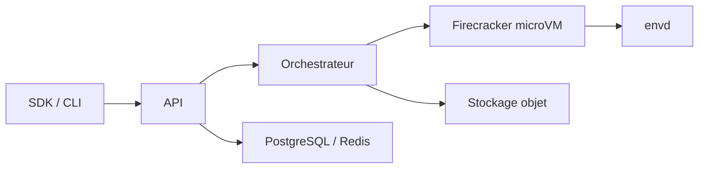

# e2b-dev/runtime

> Open-source backend of E2B: Firecracker microVMs restored from snapshots to run agent code.

## The problem
Running untrusted code generated by an agent requires strong isolation and fast startup, which are hard to build yourself.

## What it actually does
A sandbox is a restored snapshot (memory served on demand via userfaultfd, copy-on-write disk). The control API places sandboxes; the per-node orchestrator drives Firecracker, networking and cgroups. Pause/resume, sandbox forking, templates built from Docker images, `envd` inside each VM (processes, files, ports), per-port URLs, volumes, secrets, OpenTelemetry telemetry to ClickHouse.

## How it is wired


## Trying it
```bash
mkdir e2b && cd e2b
curl -fsSL --remote-name-all "https://raw.githubusercontent.com/e2b-dev/runtime/main/embed/compose/{compose.yaml,.env}"
docker compose up -d --wait
```
```python
from e2b import Sandbox
with Sandbox.create() as sandbox:
    result = sandbox.commands.run('echo "Hello from E2B!"')
```

## Cost and gotchas
Linux with KVM required; the Embed version is "an evaluation package, not a production model". The E2B cloud requires an API key. 206 open issues.

## What it is not
Not a mere SDK: it is the whole infrastructure (API, orchestrator, proxy, build). Production self-deployment goes through the enterprise offering.

## Alternatives
No alternative named in the README.

## For you
Keep an eye on it: useful if you must self-host agent sandboxes; otherwise the E2B cloud is enough and spares you operating Firecracker.
