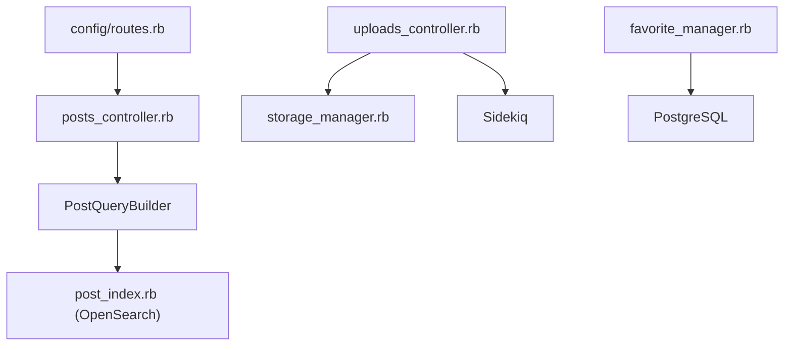

# e621ng/e621ng

> Code of an image board (imageboard) in Rails, with tag search, favorites and moderation.

## The problem
Hosting a community of tagged images requires search, moderation and media processing.

## What it actually does
A Rails application: routes, post controllers, search through an OpenSearch index, thumbnails and a browser-side blacklist (TypeScript), favorites, votes, comments, wiki, tags, administration. Uploads are stored by `storage_manager`, asynchronous jobs are handled by Sidekiq, data lives in PostgreSQL.

## How it is wired


## Trying it
```bash
cp .env.sample .env
docker compose run --rm e621 /app/bin/setup
docker compose up
docker exec -it e621ng-e621-1 /app/bin/populate
```

## Cost and gotchas
Free. Docker and Docker Compose; in production, 4 GB of RAM minimum, PostgreSQL and OpenSearch. Test admin account with a public password. License not identified by GitHub.

## What it is not
It is not a turnkey tool: the site is empty at the start and production has no install script.

## Alternatives
No alternative named in the README.

## For you
Ignore: a community image platform, unrelated to data / AI / MLOps, and with no clarity on the license.
