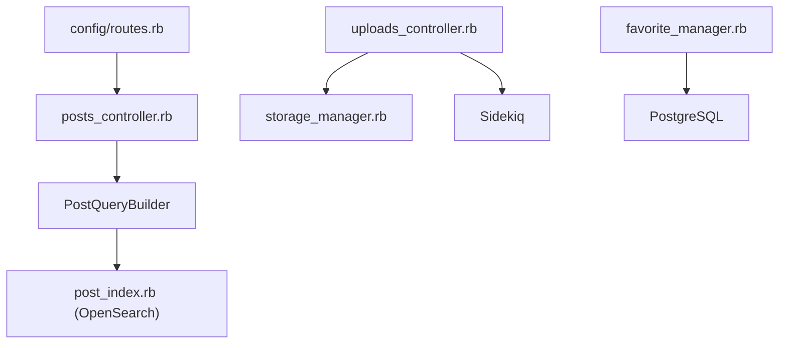

# e621ng/e621ng

> Code d'un forum d'images (imageboard) en Rails, avec recherche par étiquettes, favoris et modération.

## Le problème
Héberger une communauté d'images étiquetées demande recherche, modération et traitement de médias.

## Ce que ça fait vraiment
Application Rails : routes, contrôleurs de messages, recherche via un index OpenSearch, vignettes et liste noire côté navigateur (TypeScript), favoris, votes, commentaires, wiki, étiquettes, administration. Téléversements stockés par `storage_manager`, traitements asynchrones par Sidekiq, données en PostgreSQL.

## Comment c'est branché


## Essayer
```bash
cp .env.sample .env
docker compose run --rm e621 /app/bin/setup
docker compose up
docker exec -it e621ng-e621-1 /app/bin/populate
```

## Coût et pièges
Gratuit. Docker et Docker Compose ; en production, 4 Go de RAM minimum, PostgreSQL et OpenSearch. Compte admin de test avec mot de passe public. Licence non identifiée par GitHub.

## Ce que ce n'est pas
Ce n'est pas un outil clés en main : le site est vide au départ et la production n'a pas de script d'installation.

## Alternatives
Aucune alternative nommée dans le README.

## Pour toi
À ignorer : plateforme communautaire d'images, sans lien avec data / IA / MLOps, et sans clarté sur la licence.

