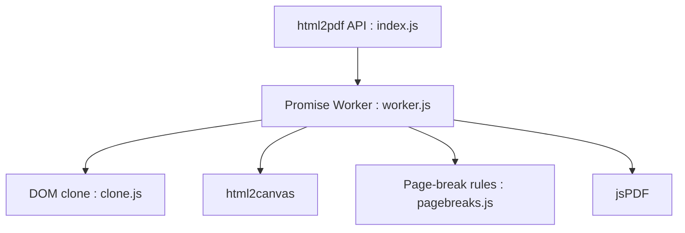

# eKoopmans/html2pdf.js

> JavaScript library that converts an HTML page or element to PDF directly in the browser.

## The problem
Generating a PDF from HTML without a rendering server.

## What it actually does
Clones the element, renders it to a canvas via html2canvas, splits the image into pages and produces the PDF with jsPDF. Handles CSS page breaks and links. Works in the browser only, not under Node.js.

## How it is wired


## Trying it
```bash
npm install --save html2pdf.js
```
```js
html2pdf(document.getElementById('element-to-print'));
```

## Cost and gotchas
Free. Text is rendered as an image: not selectable, heavy files. Canvas size limit: large documents may come out blank. 501 open issues.

## What it is not
Not a vector PDF engine nor a server-side tool. The README lists its known flaws (node cloning, resizing).

## Alternatives
- jsPDF: the output building block used directly, lower level.
- html2canvas: the rendering engine on which quality depends.

## For you
Worth watching: handy for exporting a report or dashboard from a page, but unsuited to reliable or text-based PDF generation.
