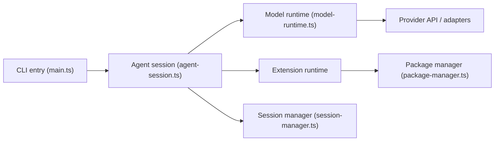

# earendil-works/pi

> Minimalist and extensible TypeScript agent harness, with CLI, SDK, and shareable packages.

## The problem
Code libraries provide pre-built functions (e.g., helper functions, mode plan), but adapting them to your specific workflow requires forking.

## What it actually does
Pi is an interactive command-line interface (also available in print/JSON, RPC, or SDK mode) without sub-agents or a default plan mode: they are added through extensions, skills, prompt templates, and themes, which are shared as npm or Git packages. The monorepo also contains a multi-provider LLM API, an agent runtime, a persistent runtime, a TUI library, and telemetry contracts. There is no built-in permission system.

## How it is wired


## Trying it
```bash
curl -fsSL https://pi.dev/install.sh | sh
npm install -g --ignore-scripts @earendil-works/pi-coding-agent
cd /path/to/project
pi
nix run github:earendil-works/pi/stable
```

## Cost and gotchas
Node 22.19+; connection via subscription or API key via `/login`. No sandbox: the README recommends Docker, micro-VM Gondolin, or OpenShell. New issues and pull requests from new contributors are automatically closed.

## What it is not
This is not a ready-to-use agent with a "mode" or sub-agents. It does not operate independently; it requires your permissions. The README does not document benchmarks or detailed functionality.

## Alternatives
- OpenClaw: Real implementation of Pi, as cited in the README.
- pi-chat: Slack/chat automation by the same organization.

## For you
Things to watch out for: It's interesting if you want a harness that you can customize or integrate using the SDK, but containerize it and wait until you have a specific need for expansion.
